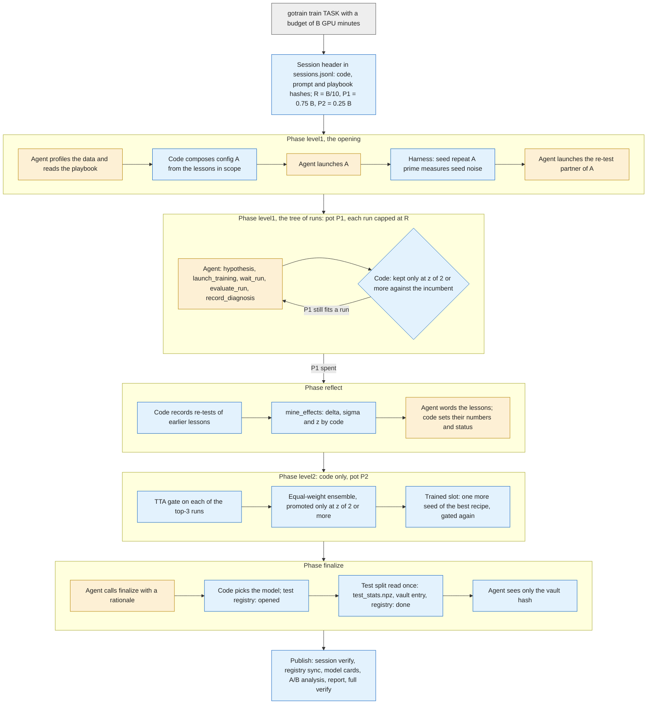
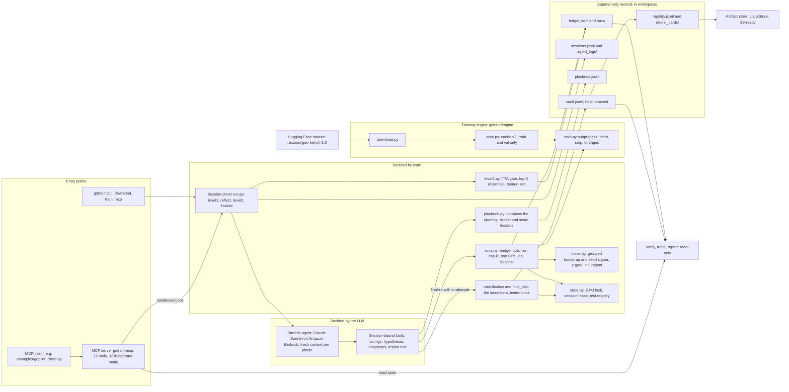

# GoTrain

[](https://pypi.org/project/gotrain/) [](https://pypi.org/project/gotrain/) [](https://github.com/yaranoun/GoTrain/actions/workflows/tests.yml) [](https://github.com/yaranoun/GoTrain/blob/main/LICENSE)

**Each dataset leaves measured lessons for the next one.**

GoTrain is an agent that trains Earth-observation models on its own. Given a dataset from GEO-Bench, a public benchmark of Earth-observation tasks
([Lacoste et al., 2023](https://arxiv.org/abs/2306.03831)), it profiles the
data, picks a configuration, trains on one GPU, reads its validation score and its mistakes, and iterates. It also
carries what it learned to the next dataset: a playbook of scoped lessons whose effects are measured by code,
re-tested, and then confirmed, narrowed or refuted.

It learns at three levels. **Level 1** (one dataset): a tree of training runs, each with the same GPU-minute cap,
where a change is kept only if its gain beats measured noise (z ≥ 2). **Level 2** (one dataset): models from models,
built by code with no LLM: a gated test-time augmentation, a top-3 ensemble and one trained slot (an extra seed of the best recipe). **Level 3**
(across datasets): the playbook, whose lessons are config changes measured by code and re-tested on the next
dataset. A held-out 5th dataset, run with and without the playbook under a protocol written down in advance, tests
Level 3. Related training agents work within one task; GoTrain's playbook carries lessons across datasets
([how it differs](#how-it-differs-from-related-agents)).

Built for the AUB ACM × RASID GoTrain hackathon (31 Oct – 1 Nov 2026); GoTrain is not an official RASID product. One
agent and one dataset-agnostic system prompt: Claude Sonnet on Amazon Bedrock (`eu-central-1`) with Strands, on one
SageMaker GPU instance. Shipped as a Python package (`pip install gotrain`) and as an MCP server that any MCP client
can call, including a host assistant such as GoPilot, RASID's geospatial AI assistant.

**At a glance.** Six GEO-Bench datasets trained by the agent under the same 60 GPU-minute budget each. Five were
tested by code, each with one test evaluation of the model selected on validation (m-eurosat also has one earlier,
voided evaluation, disclosed as [INC-001](#disclosed-incidents)):

| Dataset | Task | Test score (95% interval) | Tested model |
|---|---|---|---|
| m-eurosat | classification, 10 classes | accuracy 98.60% (97.80%–99.30%); see [INC-001](#disclosed-incidents) | ensemble of 4 |
| m-brick-kiln | classification, 2 classes | accuracy 98.60% (97.80%–99.30%) | ensemble of 3 |
| m-pv4ger-seg | segmentation, solar panels | mIoU 0.9505 (0.9418–0.9579) | one model with test-time augmentation |
| m-cashew-plant | segmentation, plantations | mIoU 0.8729 (2 test locations: interval not meaningful) | ensemble of 3, each with test-time augmentation |
| m-SA-crop-type | segmentation, held out | no test score ([INC-002](#disclosed-incidents)); Level 2 val mIoU 0.4145 | none: code selected an ensemble of 4 on validation; its one test evaluation was killed |
| m-nz-cattle | segmentation, cattle in aerial RGB | mIoU 0.8531 (0.8450–0.8615) | ensemble of 3, each with test-time augmentation |

m-eurosat and m-brick-kiln each made 14 test errors (986/1000 and 985/999), hence the same cell.

On a held-out dataset, run once with and once without the playbook, the playbook's opening config gave the agent a
stronger first run (val mIoU 0.382 vs 0.345) and the lead for the first 28.7 of 45 GPU minutes; by the end of Level 1
both arms were within noise of each other (0.402 vs 0.407): one paired run, suggestive, not proof
([details](#with-vs-without-the-playbook)). GoTrain also ships a versioned model registry (`<task>:vN`, five models
in production) with code-written model cards, an artifact store (the file system in use, an S3 backend behind the
same interface), and an MCP server with 27 tools ([Production layer](#production-layer), [MCP server](#mcp-server)).

Every score traces back to the agent's own tool call in seven checked steps ([Trace a score](#trace-a-score)). On a
fresh clone the gitignored checkpoints show as missing; every other hash checks.

## Contents

[Quickstart](#quickstart) · [What the agent works with](#what-the-agent-works-with) · [Results](#results) ·
[How it works](#how-it-works) · [Architecture](#architecture) · [Tutorial: train a model](#tutorial-train-a-model-with-the-agent) ·
[MCP server (tutorial)](#mcp-server) · [Design decisions](#design-decisions) · [Findings](#findings) ·
[Integrity and reproducibility](#integrity-and-reproducibility) · [Trace a score](#trace-a-score) ·
[Production layer](#production-layer) · [From source](#from-source) · [Layout](#layout) · [Roadmap](#roadmap) ·
[Data notes](#data-notes) · [References](#references) · [License](#license)

## Quickstart

```bash
pip install gotrain
# or from GitHub: pip install "git+https://github.com/yaranoun/GoTrain.git@v1.0.0"
gotrain download m-eurosat
GOTRAIN_CACHE="$HOME/.gotrain/cache" python -m gotrain.engine.data build m-eurosat   # train/val cache, once per task
gotrain train m-eurosat --budget 10   # the agent trains a model on its own (budget in GPU minutes)
gotrain mcp                           # MCP server for any MCP client
gotrain --version                     # gotrain 1.0.0
```

| Command | Needs |
|---|---|
| `gotrain download <task>` | network and disk (Hugging Face `recursix/geo-bench-1.0`) |
| `python -m gotrain.engine.data build <task>` | the dataset downloaded (on a pip install, set `GOTRAIN_CACHE="$HOME/.gotrain/cache"` so `gotrain train` finds it) |
| `gotrain train <task> --budget <GPU min> [--dry-run]` | the dataset downloaded and its train/val cache built, an NVIDIA GPU (not for `--dry-run`), and AWS credentials with Amazon Bedrock access to `eu.anthropic.claude-sonnet-5-5` in `eu-central-1` |
| `gotrain mcp [--http] [--check]` | nothing more: the MCP server runs on a CPU |

Requires Linux and Python ≥ 3.12. On a CPU-only machine, install CPU torch first so pip does not pull the CUDA
build: `pip install torch torchvision --index-url https://download.pytorch.org/whl/cpu`.

Installed from pip, the results workspace, the MCP sandbox and the data cache default under `GOTRAIN_HOME`
(`~/.gotrain`); datasets go to `GEO_BENCH_DIR` (GEO-Bench's default folder) and the machine-wide GPU lock and test
registry to `GOTRAIN_STATE_DIR` (`~/.gotrain-state`). That results workspace counts as a sandbox, so
`gotrain train` runs arm `dev` and the test split is never opened. Step-by-step guides:
[Tutorial: train a model with the agent](#tutorial-train-a-model-with-the-agent) and
[MCP server](#mcp-server); full MCP guide:
[docs/MCP.md](https://github.com/yaranoun/GoTrain/blob/main/docs/MCP.md).

## What the agent works with

One dataset-agnostic prompt (`gotrain/prompts/`: a system prompt plus one file per phase) and a set of Strands tools
(`gotrain/tools/`). A hygiene test fails if the prompt names any dataset, class, sensor, band id or GSD value
(`tests/test_step6.py`).

| Job | Tools |
|---|---|
| Explore the data | `profile_dataset`, `save_profile_notes` (band stats, class balance, true/false colour and NDVI grids the agent looks at) |
| Train on the GPU | `list_backbones`, `get_budget`, `launch_training`, `check_run`, `wait_run`, `kill_run` |
| Evaluate and compare runs | `evaluate_run`, `record_diagnosis`, `compare_runs`, `query_ledger`, `show_tree` |
| Carry lessons across datasets | `read_playbook`, `compose_config`, `mine_effects`, `add_lesson`, `request_knob` |

**Each test split is opened once, by code.** The agent tunes on validation only and never sees a test score: only
`final_test` can load a test split, a machine-wide test registry records an `opened`/`done` pair per dataset
(`workspace/test_registry.jsonl`), every test score sits in a hash-chained vault (`workspace/vault.jsonl`), and the
agent only ever receives the vault hash. See [Integrity and reproducibility](#integrity-and-reproducibility).

## Results

Each test score comes from the one `finalize` of the model code selected on validation (m-eurosat's earlier, voided
evaluation is [INC-001](#disclosed-incidents)), with a 95% grouped bootstrap interval computed from that test pass's
`test_stats.npz`. Val and Test are accuracy for classification (shown as %) and mIoU for segmentation (shown as 0–1).

### Score at each stage vs the best GEO-Bench baseline

| Dataset | Metric | First run (val) | Best Level 1 (val) | Level 2 (val) | Test (95% interval) | Best GEO-Bench baseline (model) |
|---|---|---|---|---|---|---|
| m-eurosat | accuracy | 98.00% | 98.90% | 98.90% | 98.60% (97.80%–99.30%) | 98.00% (ResNet18-MoCo-S2) |
| m-brick-kiln | accuracy | 98.60% | 99.30% | 99.30% | 98.60% (97.80%–99.30%) | 98.87% (ConvNeXt-B-timm) |
| m-pv4ger-seg | mIoU | 0.9510 | 0.9518 | 0.9556 | 0.9505 (0.9418–0.9579) | 0.9408 (ResNet18-U-Net-timm) |
| m-cashew-plant | mIoU | 0.6777 | 0.8458 | 0.8729 | 0.8729 | 0.4873 (ResNet50-U-Net-timm) |
| m-SA-crop-type | mIoU | 0.3820 | 0.4023 | 0.4145 | no test score (INC-002) | 0.3041 (ResNet101 DeepLabV3-timm) |
| m-nz-cattle | mIoU | 0.8538 | 0.8550 | 0.8583 | 0.8531 (0.8450–0.8615) | 0.8107 (ResNet50-U-Net-timm) |

Each baseline is the best mean test score in GEO-Bench's published baseline results, averaged over seeds (12; 7 on
m-SA-crop-type) and trained on the full training partition (`gotrain/baselines.json`, from ServiceNow/geo-bench at
commit 17cac9b). It is a test score, so read it against the Test column; First run, Best Level 1 and Level 2 are
validation. Those baselines all use 3-channel input, while GoTrain uses every Sentinel-2 band each dataset ships (13
on m-eurosat, 10 on m-brick-kiln, 12 on m-cashew-plant and m-SA-crop-type), so GoTrain's input differs from the
baseline's on every dataset except m-pv4ger-seg and m-nz-cattle, which are RGB aerial imagery in both. The baselines
were computed on earlier GEO-Bench releases (classification v0.8.5, segmentation v0.4) than the v1.0 used here, and on
m-cashew-plant and m-SA-crop-type GoTrain leaves class 0 ("no data") out of its mIoU while the baselines count it (on
m-nz-cattle both count it). That makes m-pv4ger-seg and m-nz-cattle the closest like-for-like cases: m-pv4ger-seg's
test mIoU of 0.9505 is above the 0.9408 baseline and m-nz-cattle's 0.8531 is above the 0.8107 baseline, in both
cases with the whole 95% interval above it. m-cashew-plant's test split covers only 2 locations, so its interval is
left out. The baselines are never shown to the agent.

*Best Level 1* is the highest validation score any Level 1 run reached. Only m-cashew-plant-0004 cleared the z ≥ 2
noise gate in Level 1 ([Findings](#findings)), so on the other datasets the incumbent was still the first run when Level 2 built its
models from the top three Level 1 runs. In the tables below, Level 1 z is measured
against the incumbent, a TTA z against the same model without TTA, and an ensemble z against the incumbent at that
moment.

<details>
<summary><b>m-eurosat</b>: every run, in order</summary>

| Run | Change tried | Val | Kept? |
|---|---|---|---|
| m-eurosat-0006 | first run: ResNet18, SSL4EO-MoCo weights, 224 px, lr 1e-3 | 98.00% | first run, incumbent |
| m-eurosat-0007 | seed repeat of 0006 (harness) | 98.70% | noise measurement (σ_seed 0.007) |
| m-eurosat-0008 | lr 1e-3 → 3e-4 | 98.80% | within noise (z +1.01) |
| m-eurosat-0009 | ResNet50 (from 0008) | 98.70% | within noise (z +0.89) |
| m-eurosat-0010 | label smoothing 0.1 (from 0008) | 98.90% | within noise (z +1.14) |
| m-eurosat-0011 | new root: ResNet18, ImageNet weights, 64 px (lr 3e-4, label smoothing 0.1) | 97.50% | within noise (z −0.55) |
| m-eurosat-0012 | 0010's recipe, new seed | 98.60% | within noise (z +0.76) |
| m-eurosat-L2-001 | TTA on 0010 | 98.90% | TTA dropped (z +0.00) |
| m-eurosat-L2-002 | TTA on 0008 | 98.60% | TTA dropped (z −1.45) |
| m-eurosat-L2-003 | TTA on 0009 | 98.70% | TTA dropped (z +0.00) |
| m-eurosat-L2-004 | ensemble of 0010, 0008, 0009 | 98.70% | not promoted (z +1.92 vs 0006) |
| m-eurosat-0015 | trained slot: 0010's recipe, new seed | 98.80% | ensemble member |
| m-eurosat-L2-006 | ensemble of 0010, 0008, 0009, 0015 | 98.90% | **promoted** (z +2.49 vs 0006); the tested model |

</details>

<details>
<summary><b>m-brick-kiln</b>: every run, in order</summary>

| Run | Change tried | Val | Kept? |
|---|---|---|---|
| m-brick-kiln-0002 | first run: ResNet18, ImageNet weights, 64 px, lr 1e-3, 15 epochs | 98.60% | first run, incumbent |
| m-brick-kiln-0003 | seed repeat of 0002 (harness) | 98.90% | noise measurement (σ_seed 0.003) |
| m-brick-kiln-0004 | SSL4EO-MoCo weights, 224 px (lesson L001) | 99.10% | within noise (z +1.26) |
| m-brick-kiln-0005 | lr 1e-3 → 3e-4 (lesson L002; from 0004) | 99.30% | within noise (z +1.55) |
| m-brick-kiln-0006 | ResNet50, 8 epochs (from 0005) | 99.00% | within noise (z +1.04) |
| m-brick-kiln-0007 | missing band B06 filled by interpolation (from 0005) | 99.30% | within noise (z +1.65) |
| m-brick-kiln-0008 | label smoothing 0.1 (from 0005) | 99.20% | within noise (z +1.54) |
| m-brick-kiln-L2-001 | TTA on 0005 | 99.20% | TTA dropped (z −0.57) |
| m-brick-kiln-L2-002 | TTA on 0007 | 99.10% | TTA dropped (z −1.41) |
| m-brick-kiln-L2-003 | TTA on 0008 | 99.20% | TTA dropped (z +0.00) |
| m-brick-kiln-L2-004 | ensemble of 0005, 0007, 0008 | 99.30% | **promoted** (z +2.32 vs 0002); the tested model |
| m-brick-kiln-0012 | trained slot: 0005's recipe, new seed | 99.30% | ensemble member |
| m-brick-kiln-L2-006 | ensemble of 0005, 0007, 0008, 0012 | 99.30% | not promoted (z +0.00 vs L2-004) |

</details>

<details>
<summary><b>m-pv4ger-seg</b>: every run, in order</summary>

| Run | Change tried | Val | Kept? |
|---|---|---|---|
| m-pv4ger-seg-0002 | first run: U-Net, ResNet34, ImageNet weights, lr 5e-4, 20 epochs (the 6-min cap ended it after 10 epochs) | 0.9510 | first run, incumbent |
| m-pv4ger-seg-0003 | seed repeat of 0002 (harness) | 0.9508 | noise measurement (σ_seed 0.00015) |
| m-pv4ger-seg-0004 | epochs 20 → 10 (the agent's idea: let the LR anneal; a re-run of 0002's recipe, see the note below) | 0.9518 | within noise (z +0.49) |
| m-pv4ger-seg-0005 | ResNet18, 14 epochs (from 0004) | 0.9505 | within noise (z −0.28) |
| m-pv4ger-seg-0006 | FPN decoder (from 0004) | 0.9502 | within noise (z −0.42) |
| m-pv4ger-seg-0007 | lr 5e-4 → 1e-3 (from 0004) | 0.9494 | within noise (z −0.97) |
| m-pv4ger-seg-0008 | ResNet50, 8 epochs (from 0004) | 0.9497 | within noise (z −0.64) |
| m-pv4ger-seg-L2-001 | TTA on 0004 | 0.9552 | TTA kept (z +2.72) |
| m-pv4ger-seg-L2-002 | TTA on 0002, the incumbent | 0.9556 | TTA kept (z +3.38); **promoted**, the tested model |
| m-pv4ger-seg-L2-003 | TTA on 0005 | 0.9531 | TTA kept (z +3.09) |
| m-pv4ger-seg-L2-004 | ensemble of 0004, 0002, 0005, each with TTA | 0.9556 | not promoted (z +0.00 vs L2-002) |
| m-pv4ger-seg-0012 | trained slot: 0004's recipe, new seed | 0.9506 | ensemble member |
| m-pv4ger-seg-L2-006 | ensemble of the three + 0012 | 0.9546 | not promoted (z −1.43 vs L2-002) |

</details>

<details>
<summary><b>m-cashew-plant</b>: every run, in order</summary>

| Run | Change tried | Val | Kept? |
|---|---|---|---|
| m-cashew-plant-0002 | first run: U-Net, ResNet34, ImageNet weights, lr 5e-4 | 0.6777 | first run, incumbent |
| m-cashew-plant-0003 | seed repeat of 0002 (harness) | 0.7446 | noise measurement (σ_seed 0.0669) |
| m-cashew-plant-0004 | ResNet18 with SSL4EO-MoCo weights (lesson L001) | 0.8177 | **kept** (z +2.08), new incumbent |
| m-cashew-plant-0005 | lr 5e-4 → 1e-3 (from 0004) | 0.8331 | within noise (z +0.23) |
| m-cashew-plant-0006 | ResNet50, SSL4EO weights (from 0005) | 0.8260 | within noise (z +0.12) |
| m-cashew-plant-0007 | FPN decoder (from 0005) | 0.7542 | within noise (z −0.95) |
| m-cashew-plant-0008 | lr 1e-3 → 2e-3 (from 0005) | 0.8458 | within noise (z +0.42) |
| m-cashew-plant-L2-001 | TTA on 0008 | 0.8730 | TTA kept (z +14.61) |
| m-cashew-plant-L2-002 | TTA on 0005 | 0.8694 | TTA kept (z +14.74) |
| m-cashew-plant-L2-003 | TTA on 0006 | 0.8602 | TTA kept (z +11.84) |
| m-cashew-plant-L2-004 | ensemble of 0008, 0005, 0006, each with TTA | 0.8729 | **promoted** (z +12.48 vs 0004); the tested model |
| m-cashew-plant-0012 | trained slot: 0008's recipe, new seed | 0.8473 | ensemble member |
| m-cashew-plant-L2-006 | ensemble of the three + 0012 | 0.8726 | not promoted (z −0.76 vs L2-004) |

</details>

<details>
<summary><b>m-SA-crop-type</b> (held out; playbook on): every run, in order</summary>

| Run | Change tried | Val | Kept? |
|---|---|---|---|
| m-SA-crop-type-0001 | first run: U-Net, ResNet18, SSL4EO-MoCo weights (playbook lesson L001), lr 5e-4 | 0.3820 | first run, incumbent |
| m-SA-crop-type-0002 | seed repeat of 0001 (harness) | 0.3326 | noise measurement (σ_seed 0.0494) |
| m-SA-crop-type-0003 | re-test of L001: ResNet34 with ImageNet weights | 0.3587 | within noise (z −0.47) |
| m-SA-crop-type-0004 | epochs 20 → 8 (a re-run of 0001's recipe, see the note below) | 0.3722 | within noise (z −0.20) |
| m-SA-crop-type-0005 | lr 5e-4 → 1e-3, 8 epochs | 0.3411 | within noise (z −0.82) |
| m-SA-crop-type-0006 | lr 5e-4 → 3e-4, 8 epochs | 0.3866 | within noise (z +0.09) |
| m-SA-crop-type-0007 | FPN decoder (from 0006) | 0.4023 | within noise (z +0.41) |
| m-SA-crop-type-L2-001 | TTA on 0007 | 0.4094 | TTA kept (z +2.46) |
| m-SA-crop-type-L2-002 | TTA on 0006 | 0.3971 | TTA kept (z +3.94) |
| m-SA-crop-type-L2-003 | TTA on 0001, the incumbent | 0.3891 | TTA kept (z +2.19); **promoted** |
| m-SA-crop-type-L2-004 | ensemble of 0007, 0006, 0001, each with TTA | 0.4105 | **promoted** (z +6.02 vs L2-003) |
| m-SA-crop-type-0012 | trained slot: 0007's recipe, new seed | 0.4002 | ensemble member |
| m-SA-crop-type-L2-006 | ensemble of the three + 0012 | 0.4145 | **promoted** (z +2.36 vs L2-004); its one test evaluation was killed (INC-002) |

Same dataset, playbook off (the A/B arm; Level 1 only, validation only; a separate workspace, so the run ids repeat):

| Run | Change tried | Val | Kept? |
|---|---|---|---|
| 0001 | first run: U-Net, ResNet34, ImageNet weights, 20 epochs | 0.3448 | first run, incumbent |
| 0002 | seed repeat of 0001 (harness) | 0.3351 | noise measurement (σ_seed 0.0097) |
| 0003 | ResNet18 with SSL4EO-MoCo weights, 10 epochs | 0.3774 | **kept** (z +2.57), new incumbent |
| 0004 | 8 epochs (from 0003; a re-run of 0003's recipe, see the note below) | 0.3634 | within noise (z −1.33) |
| 0005 | FPN decoder (from 0003) | 0.4001 | within noise (z +1.99) |
| 0006 | lr 5e-4 → 1e-3 (from 0005) | 0.3991 | within noise (z +1.88) |
| 0007 | DeepLabV3+ decoder (from 0005) | 0.4065 | **kept** (z +2.43), new incumbent |

</details>

<details>
<summary><b>m-nz-cattle</b>: every run, in order</summary>

| Run | Change tried | Val | Kept? |
|---|---|---|---|
| m-nz-cattle-0001 | first run: U-Net, ResNet34, ImageNet weights, lr 5e-4 (the defaults: no lesson applied) | 0.8538 | first run, incumbent |
| m-nz-cattle-0002 | seed repeat of 0001 (harness) | 0.8544 | noise measurement (σ_seed 0.00051) |
| m-nz-cattle-0003 | ResNet50 | 0.8537 | within noise (z −0.10) |
| m-nz-cattle-0004 | ResNet18 | 0.8533 | within noise (z −0.50) |
| m-nz-cattle-0005 | input upsampled from 500 px to 768 px (from 0004) | 0.8543 | within noise (z +0.63); became lesson L006 |
| m-nz-cattle-0006 | lr 5e-4 → 1e-3 (from 0004; a re-test of L003) | 0.8550 | within noise (z +1.22) |
| m-nz-cattle-0007 | DeepLabV3+ decoder (from 0006; recorded as a re-test of L004) | 0.8505 | **regressed** (z −3.70) |
| m-nz-cattle-L2-001 | TTA on 0006 | 0.8579 | TTA kept (z +4.63) |
| m-nz-cattle-L2-002 | TTA on 0005 | 0.8568 | TTA kept (z +5.64) |
| m-nz-cattle-L2-003 | TTA on 0001, the incumbent | 0.8558 | TTA kept (z +4.18); **promoted** |
| m-nz-cattle-L2-004 | ensemble of 0006, 0005, 0001, each with TTA | 0.8583 | **promoted** (z +5.26 vs L2-003); the tested model |
| m-nz-cattle-0012 | trained slot: 0006's recipe, new seed | 0.8556 | ensemble member |
| m-nz-cattle-L2-006 | ensemble of the three + 0012 | 0.8581 | not promoted (z −0.91 vs L2-004) |

</details>

Sources: `workspace/ledger.jsonl` (last row per run), `report/trees/<task>__main__chain.txt`, `report/level2.md`,
the `[level2]` lines in `logs/chain.log` (for m-nz-cattle, in `logs/nz-cattle.log`), and for the OFF arm
`experiments/playbook-ab/m-SA-crop-type/off/workspace/ledger.jsonl`. Run ids are numbered from the number of runs the
task already has in the ledger, Level 2 composites and the trained slot included, so the numbers have gaps (and no
L2-005). m-brick-kiln, m-pv4ger-seg and m-cashew-plant start at 0002 because a run folder 0001 from an earlier manual
run already existed (`gotrain/engine/train.py` skips existing folders; `logs/<task>-0001.log`).

`epochs` is not a knob (`gotrain/knobs.py`): under the run cap the learning rate anneals on elapsed time to the stop,
so an epoch count in these tables changes nothing. The three rows that changed only `epochs` (m-pv4ger-seg-0004,
m-SA-crop-type-0004 and the OFF arm's 0004) have an empty knob diff and the same recipe hash and seed as their
parent: they are re-runs of the parent's recipe.

### Full results table (generated from the vault)

The report generator writes this block (`python -m gotrain.report --readme`) from the same rows as
`report/results.md` (vault, ledger, sessions) plus `experiments/playbook-ab/*/metrics.json`. It adds the GPU minutes,
tokens and lessons per dataset, and repeats on each reference the protocol notes summarised under the table above
(see also `report/dashboard.html`).

<!-- results:begin (written by python -m gotrain.report --readme; do not edit by hand) -->

| Task | Model | Val | Test (95% interval) | GEO-Bench reference | GPU-min L1 / L2 | Tokens | Lessons born / applied | Notes |
|---|---|---|---|---|---|---|---|---|
| m-eurosat | m-eurosat-L2-006 (composite) | 98.90% | 98.60% (97.80%–99.30%, 1000 groups) | 98.00% (not comparable: bands differ (3-channel reference, we use 13); benchmark classification v0.8.5 vs our v1.0) | 40.8 / 6.3 | 208,496 | 2 / 0 | INC-001 disclosed |
| m-brick-kiln | m-brick-kiln-L2-004 (composite) | 99.30% | 98.60% (97.80%–99.30%, 999 groups) | 98.87% (not comparable: bands differ (3-channel reference, we use 10); benchmark classification v0.8.5 vs our v1.0) | 40.8 / 6.2 | 188,252 | 0 / 0 |  |
| m-pv4ger-seg | m-pv4ger-seg-L2-002 (composite) | 0.9556 | 0.9505 (0.9418–0.9579, 403 groups) | 0.9408 (roughly comparable: benchmark segmentation v0.4 vs our v1.0) | 40.7 / 7.5 | 188,292 | 2 / 0 |  |
| m-cashew-plant | m-cashew-plant-L2-004 (composite) | 0.8729 | 0.8729 (0.8709–0.8755, 2 groups) | 0.4873 (not comparable: bands differ (3-channel reference, we use 12); benchmark segmentation v0.4 vs our v1.0; class 0 ('no data') ignored by us, counted by the reference) | 40.6 / 7.2 | 203,781 | 1 / 0 |  |
| m-SA-crop-type | — | — | not finalized | 0.3041 (not comparable: bands differ (3-channel reference, we use 12); benchmark segmentation v0.4 vs our v1.0; class 0 ('no data') ignored by us, counted by the reference) | 39.7 / 8.6 | 199,328 | 0 / 1 | INC-002 disclosed |
| m-nz-cattle | m-nz-cattle-L2-004 (composite) | 0.8583 | 0.8531 (0.8450–0.8615, 63 groups) | 0.8107 (roughly comparable: benchmark segmentation v0.4 vs our v1.0) | 40.8 / 6.7 | 249,161 | 1 / 0 |  |

With vs without the playbook (`experiments/playbook-ab/analyze.py`; n = 1, val only):

- **m-SA-crop-type** (held out; B = 60, R = 6): anytime AUC ON 0.3394 vs OFF 0.3326 (Δ +0.0068); best val at P1 0.4023 vs 0.4065; first run 0.3820 vs 0.3448; σ_AB 0.0497.

<!-- results:end -->

### With vs without the playbook

On a held-out dataset, with the protocol written down before it ran
([PROTOCOL.md](https://github.com/yaranoun/GoTrain/blob/main/experiments/playbook-ab/PROTOCOL.md), frozen at tag
`freeze-f1` with the hash of `analyze.py`): one paired run, reported with ±2σ bands, whatever the result. Both arms
ran the same code with B = 60, R = 6, 7 runs each (6 decision runs) and about 39.7–39.9 GPU minutes. All 10
integrity checks in `analyze.py` pass (`experiments/playbook-ab/m-SA-crop-type/metrics.json`).


**The playbook gave the agent a better start on a dataset it had never seen.** Its opening config, composed from the
SSL4EO lesson L001 (born on m-eurosat, confirmed on m-cashew-plant), scored val mIoU 0.382 on the first run against
0.345 for the default opening, and the playbook arm's best model stayed ahead for the first 28.7 of its 45 Level 1
GPU minutes (the blue area). Across every run of the two opening configs in both arms, the playbook's averaged 0.366
(5 runs, 0.333–0.382) against 0.346 for the default (3 runs, 0.335–0.359). Measured as time to a fixed score, the
head start depends on the threshold: at 0.38, set after the runs at the playbook arm's first score, it was 5.7 GPU
minutes against 28.7; at 0.375, 5.7 against 17.5.

| Metric (validation, mIoU) | Playbook ON | Playbook OFF | Δ |
|---|---|---|---|
| First run | 0.3820 | 0.3448 | +0.0372 |
| Opening config, mean of every run in both arms | 0.366 (5 runs) | 0.346 (3 runs) | +0.020 |
| Anytime AUC over P1 (pre-registered primary) | 0.3394 | 0.3326 | +0.0068 |
| Minutes to within 2σ of the best (pre-registered) | 5.7 | 5.75 | tie |
| Wasted runs (pre-registered: within noise, regressed or a repeated recipe) | 5 | 3 | |
| Best val at the end of Level 1, V(P1) | 0.4023 | 0.4065 | −0.0042 |
| σ_AB | 0.0497 | | |

Given the whole Level 1 budget, the OFF arm caught up: it found the same weights on its third run (0.377 at 17.5 GPU
min), passed ON's best-so-far with an FPN decoder on its fifth (0.400 at 28.7 GPU min), and its seventh run (0.4065)
ended 0.004 above ON's best (0.4023): OFF finished slightly ahead, within noise. Every difference is inside 2σ
(σ_AB ≈ 0.05): one paired run suggests a head start; it does not prove one. The figure is drawn from the two arms'
ledgers (`workspace/ledger.jsonl` and `experiments/playbook-ab/m-SA-crop-type/off/workspace/ledger.jsonl`) by
`scripts/plot_head_start.py`; the protocol's own plot with ±2σ bands is `report/ab_m-SA-crop-type.png`. The ON arm read the frozen snapshot
`experiments/playbook-ab/playbook-snapshot.jsonl` (sha256 `a39fdb49…89107eb`, logged in `logs/chain.log` and in the
ON session's header in `workspace/sessions.jsonl`). One nuance: the ON arm's seed noise (0.049) was about 5× the OFF
arm's (0.0097), so its gate was stricter: ON kept 0 Level 1 runs, OFF kept 2.

### How to read the results

- m-cashew-plant's val and test mIoU agree to six decimals by coincidence, not leakage: val 0.8729061 (400 images
  from 16 locations, `val_stats.npz`, ledger row written 31 Oct 22:45:55 UTC) and test 0.8729064 (50 images from 2
  other locations, `test_stats.npz`; the test split was opened, its one touch, at 22:52:17 UTC). The splits share no image and
  no location, the two stats files have different hashes, and the per-class IoUs differ by up to 0.05 (test: the
  vault's `per_class_iou`; val: `workspace/runs/m-cashew-plant/m-cashew-plant-L2-004/val_stats.npz`).
  `python -m gotrain.trace m-cashew-plant` re-scores the test number from `test_stats.npz`. With only 2 test
  locations its 95% interval is not meaningful; the 400-image validation split is the steadier signal.
- m-SA-crop-type, the 5th dataset: code chose the Level 2 ensemble `m-SA-crop-type-L2-006` (val mIoU 0.4145,
  `report/level2.md`); its one test evaluation is the one INC-002 killed, so it has no test score.
- The tested model is the one code promoted, not always the highest val: on m-cashew-plant the TTA model L2-001
  (val 0.8730) was not promoted, the ensemble L2-004 (0.8729) was.
- Operational note: at 00:16 UTC the m-SA-crop-type Level 2 step was refused because the OFF arm's last training
  process still held the GPU lock (`logs/chain.log`). The chain paused itself, the process was stopped, a reaper was
  started (`logs/reaper.log`, 00:17:47 UTC), and the chain resumed at 00:17:53 UTC. No result was affected.
- m-nz-cattle, the 6th dataset, ran after the chain had finished, on 1 Nov, in a separate clone (arm main, B = 60,
  same prompt, a later code tree; logs `logs/nz-cattle*.log` rather than `logs/chain.log`): Level 1, reflect and Level 2 from
  10:32 to 11:21 UTC, and its one finalize at 12:20 UTC as a separate invocation; its session id is still
  `m-nz-cattle__main__chain`, so the `<task>__main__chain` paths in this README cover it. It started from the playbook the
  first five datasets left (lessons L001–L005).

### Disclosed incidents

**INC-001 (m-eurosat).** On 31 Oct, while the agent's tools were being checked by hand in a notebook
(`notebooks/step3_tools_check.ipynb`), the notebook passed a killed 5-epoch tool-check run (`m-eurosat-0005`) to
`finalize`, and the m-eurosat test split was evaluated once (test accuracy
0.895). No model, config or decision was chosen with it. The vault entry was voided and kept verbatim
(`workspace/vault_incidents.jsonl`), and m-eurosat was finalized once more with a model selected on validation only.
Its score is reported together with this incident. The fixes are in code: finalize accepts only finished runs, tool
checks run in a sandbox where finalize refuses, and a machine-wide test registry allows one test touch per dataset.

**INC-002 (m-SA-crop-type).** On 1 Nov at 00:28 UTC, the held-out m-SA-crop-type's one test evaluation was killed by
the kernel's out-of-memory killer while it loaded the test split into memory. The test registry had already
recorded `opened` (00:26:49 UTC), by design before any test data is read. No prediction, metric or `test_stats.npz`
was produced, and there is no vault entry; the split had been written to the gitignored
`workspace/cache/m-SA-crop-type/test.npz`. By our own rule an `opened` line without `done` uses up the dataset's one
test touch, so `final_test` refuses m-SA-crop-type, and we report it without a test score: the guard held even
against us (`workspace/vault_incidents.jsonl`). Its with/without-playbook result uses the validation split only, by
protocol, so it is unaffected. The fix, a memory-lean test loader, is on the [roadmap](#roadmap).

## How it works

| Level | Scope | What learns | Mechanism |
|---|---|---|---|
| 1 | one dataset | the agent's choices | A tree of training configs. Every decision run gets the same GPU-minute cap R. A change is kept only if its gain beats measured noise (z ≥ 2). |
| 2 | one dataset | the models | Models built from models: a gated test-time augmentation, a top-3 ensemble and one trained slot. Run by code, no LLM. |
| 3 | across datasets | the agent's know-how | A playbook of lessons, each a config change with an effect, noise and scope measured by code. The next dataset applies the lessons in scope and re-tests the one with the most at stake. |

### How it differs from related agents

The closest agents for training models work within one task and do not carry lessons across datasets: RSI4EO runs
each task in an offline container where "nothing else the agent created survives" but the graded submission; AIDE
searches a tree of solutions within one task; and autoresearch keeps a results log and git history for one training
script under a fixed 5-minute budget. A study of autoresearch on solar-panel segmentation finds that "retained
modifications do not transfer across hardware", which is our reason to scope and re-test lessons. Cross-task memory does exist elsewhere:
Auto-sklearn warm-starts from the nearest datasets, ExpeL distils natural-language insights from training tasks, ACE
treats contexts as "evolving playbooks", DS-Agent uses case-based reasoning, HASTE "reloads skills learned from
earlier competitions", and ML-Master 2.0 builds "cross-task wisdom". What GoTrain adds: every lesson is a
machine-checkable config change with an effect and noise measured by code, scoped by Earth-observation features
(sensor, bands, GSD, task type), re-tested on the next dataset and confirmed, narrowed or refuted, and the whole
playbook is evaluated by a with/without comparison, written down in advance, on a held-out dataset. Full citations:
[References](#references).

### Running order

The levels are numbered by scope, not by running order. A new dataset starts with no trained models: the playbook
gives the first config, the Level 1 tree trains models, and only then does Level 2 combine the best of them. The
running order of one session is:

**profile → read playbook → compose the first config A → seed repeat A′ (harness) → re-test A⁻ / A⁺ → Level 1 tree
→ reflect (write lessons) → Level 2 → finalize once → publish.**


### One dataset session



Yellow steps are the agent's tool calls, blue steps are code, and the grey box is your command. Phase names are
exactly `level1`, `reflect`, `level2` and `finalize`, run in that fixed order by `gotrain/run.py`; the agent phases
(`level1`, `reflect`, `finalize`) each run in a fresh agent context with its own transcript, and `level2` is code.

### Budget and noise

- **Budget.** B GPU minutes per dataset (B = 60 on every dataset and in both A/B arms). Each decision run gets
  exactly R = B/10 = 6 minutes, startup and validation included, and the learning rate anneals to that stop. Level 1
  spends from P1 = 0.75·B = 45; Level 2 and finalize from P2 = 0.25·B = 15. A launch is refused when its pot has
  less than R left. Short screens of R/3 only rank options, at most 2, and never become the incumbent or lesson
  evidence.
- **Noise gate.** σ = √(sd_boot² + σ_seed²), where sd_boot comes from a paired bootstrap on validation that
  resamples whole groups (locations or field tiles where the dataset has them; 2,000 replicates, seed 0) and
  σ_seed = |val(A′) − val(A)| from the harness seed repeat. z = Δ/σ: kept at z ≥ 2, regressed at z ≤ −2, otherwise
  within noise. The incumbent is the first finished decision run and changes only at z ≥ 2. Model-selection steps
  (TTA, ensembles) use the bootstrap alone.
- **One change at a time.** An `improve` run changes exactly one knob group (backbone, weights, norm and image size
  count as one), so every pair is a clean one-change effect that can become a lesson.

### Lessons (Level 3)

- In `reflect`, code lists qualifying pairs (two agent runs of the session, one knob group apart). The agent words
  the lesson and its intended scope; code fills in change, Δ, σ, z and scope.
- |z| ≥ 2 makes a *hypothesis* (applied next time); 1 ≤ |z| < 2 makes a *lead* (offered for testing only); weaker
  effects are refused. At most 5 lessons per dataset; negative lessons are allowed.
- Scope uses Earth-observation features only: task type, sensor family, band family, GSD bucket, plus the weights
  family as context. On a new dataset, code sorts lessons into apply / other context / to test / avoid / hidden,
  ranked by confidence × profile similarity. A lesson is never applied to an unknown scope.
- Re-test: A⁻ removes the applied lesson with the most at stake (largest |effect| × (1 − confidence)); A⁺ adds the
  top to-test lesson when nothing applies. z ≥ 2 confirms, z ≤ −2 refutes, anything else is inconclusive. A lesson
  is *confirmed* after confirmations on 2 or more datasets and no refutation; a refutation narrows its scope, or
  marks it contradicted if refutations ≥ confirmations. Confidence = (1 + C)/(2 + C + R).
- The playbook is append-only, never written by hand, and the only channel between datasets.

### What the agent decides and what code decides

| The agent (Claude Sonnet, via tools) | Code |
|---|---|
| profile notes from the stats and the image grids | the budget pots, the run cap R, the stop of every run |
| which config change to try next, its parent, and the hypothesis text | the seed repeat, the noise σ, z, the outcome and the incumbent |
| killing its own runs, evaluating, and the diagnosis text (it looks at failure images) | the one-knob-group rule and the tree move |
| in `reflect`, which measured effects become lessons, the statement and the intended scope | every number in a lesson, its status and confidence |
| `request_knob`: a logged wish for a knob that does not exist | all of Level 2: members, gates, the trained slot |
| calling `finalize` with a rationale | which model is tested, the single test touch, the vault entry |

The test split is opened **once per dataset, machine-wide**, by code. The agent only ever sees the vault hash, never
a test score, and the agent's message in the finalize transcript is narration, not the decision.

## Architecture



| Component | Owns |
|---|---|
| `gotrain/cli.py`, `mcp_cli.py` | the `gotrain` and `gotrain-mcp` commands, preflight checks (task known, dataset downloaded, CUDA GPU, AWS credentials) |
| `gotrain/run.py`, `session.py` | the session driver: arms `main` / `off` / `dev`, the four phases in order, budget pots, the session header with code-tree, prompt and playbook hashes |
| `gotrain/agent.py`, `hooks.py`, `prompts/` | the Strands `Agent` with `BedrockModel` (`eu.anthropic.claude-sonnet-5-5`, `eu-central-1`); tools per phase (level1 16, reflect 9, finalize 3); serial tool calls; output caps |
| `gotrain/tools/` | Strands tools bound to one session by closures; no tool takes a task argument, and run ids are checked against the session |
| `gotrain/runs.py`, `noise.py`, `knobs.py` | launch (pot check, cap, one-group rule, GPU lock, ledger row), the harness seed repeat, Sentinel, incumbent, evaluate, compare, tree, finalize |
| `gotrain/playbook.py` | Level 3: retrieval buckets, the composed opening, re-test partners, `mine_effects`, `add_lesson`, `record_tests`, status rules |
| `gotrain/level2.py` | Level 2, code only and under the GPU lock: TTA gate, ensemble, trained slot; composites are ledger rows |
| `gotrain/state.py` | machine-wide state in `$GOTRAIN_STATE_DIR`: the GPU lock (refused, never waited on), the session lease, the test registry |
| `gotrain/engine/` | tasks and band fixes, download, cache v2, model zoo (timm, segmentation-models-pytorch, torchgeo SSL4EO), time-capped training, evaluation and `final_test` |
| `gotrain/registry.py`, `model_card.py`, `store.py` | versioned model registry, code-written model cards, the artifact store (LocalStore, S3Store) |
| `gotrain/verify.py`, `trace.py`, `report.py` | read-only checks, the score trace, results, trees, lesson flow, dashboard and the README results block |
| `gotrain/mcp_server.py`, `jobs.py`, `mcp_ops.py`, `predict.py`, `mcp_config.py` | the MCP server, its background jobs, read-only operations, single-image prediction, folder defaults |
| `scripts/chain.sh`, `scripts/publish.sh` | the unattended, resumable GPU queue and the post-chain publication steps |

**Data flow.** `hf_hub_download("recursix/geo-bench-1.0")` → extracted to `GEO_BENCH_DIR` → cache v2
(memory-mapped, narrowest lossless dtype, train and val only, channels selected and reordered by `tasks.CHANNELS`,
built only by a GPU-lock holder) → float32 per batch, normalised per weights family (÷10000 for SSL4EO, z-score
otherwise). The test split never enters cache v2; only `final_test` loads it, through its own float32 `.npz`
(`workspace/cache/<task>/test.npz`, gitignored).

## Tutorial: train a model with the agent

This walks one dataset through a full sandbox session from a pip install. Training needs Linux, an NVIDIA GPU and
AWS credentials with Bedrock access.

**1. Install and check.**

```bash
pip install gotrain
gotrain --version            # gotrain 1.0.0
```

Configure AWS credentials with access to `eu.anthropic.claude-sonnet-5-5` in `eu-central-1` (`aws configure`,
`AWS_PROFILE`, or an instance role).

**2. Download a dataset.**

```bash
gotrain download m-eurosat   # from Hugging Face recursix/geo-bench-1.0 into GEO_BENCH_DIR; skipped if already there
```

Trainable tasks (they have a channel plan): `m-eurosat`, `m-brick-kiln`, `m-pv4ger-seg`, `m-cashew-plant`,
`m-SA-crop-type`, `m-nz-cattle`. Then build its train/val cache once (a session reads the cache before its first
run, dry runs included):

```bash
GOTRAIN_CACHE="$HOME/.gotrain/cache" python -m gotrain.engine.data build m-eurosat
```

Use `$GOTRAIN_HOME/cache` if you set `GOTRAIN_HOME`; in a source checkout drop the variable; over MCP, `build_cache`.

**3. Let the agent plan without training (optional).**

```bash
gotrain train m-eurosat --budget 10 --dry-run   # the agent plans on Bedrock; nothing is launched, no GPU needed
```

**4. Run a session.**

```bash
gotrain train m-eurosat --budget 10 --phases level1,reflect,level2
```

The default phases end with `finalize`, which refuses in a sandbox (and an installed package always runs in one),
so the command above stops before it. With `--budget 10` each decision run gets R = 1 GPU minute, Level 1 gets
P1 = 7.5 and Level 2 gets P2 = 2.5. Before anything starts, `gotrain train` checks the task, the dataset, the GPU and
the credentials, and prints one line per problem (exit 2), for example:

```
gotrain train: cannot start:
  - --budget MIN is required for a new session (GPU minutes for this dataset, e.g. --budget 10)
```

While it runs, it prints the session line, one transcript path per phase, and a closing line per phase:

```
Session m-eurosat__dev__<UTC stamp> · arm dev · B 10.0 (R 1.0, P1 7.5, P2 2.5) · workspace <workspace> (SANDBOX)
[level1] transcript: <workspace>/agent_logs/<session>.level1.jsonl
[level1] end: N tool calls, M min, tokens {...} (transcript <session>.level1.md)
```

Level 2 is code, so it prints its own `[level2]` gate lines instead of a transcript.

**5. Read what it wrote.** Everything lands under `~/.gotrain/workspace` (or `GOTRAIN_WORKSPACE`):

| File | What it holds |
|---|---|
| `sessions.jsonl` | the session header (budget, code tree, prompt and playbook hashes, model, versions), the opening, `sigma_seed`, phase ends |
| `agent_logs/<session>.<phase>.{jsonl,md}` | every agent message and tool call, per phase |
| `ledger.jsonl` | one row per run: parent, knob change, hypothesis, outcome with delta, sigma and z |
| `runs/<task>/<run_id>/` | config, history, metrics, status, `val_stats.npz`, checkpoint, plots |
| `playbook.jsonl` | the lessons the session wrote (arm `dev` and `main`; never arm `off`) |
| `../logs/<run_id>.log` | the training log of each run (installed: `~/.gotrain/logs`) |

To continue a session or run later phases, pass `--session-id <session>`. `gotrain train m-eurosat -- --help`
lists every flag of the session driver (`--arm`, `--phases`, `--session-id`, `--max-tool-calls 150`,
`--max-wall-min`, `--max-nudges 3`). To browse the session from an MCP client, start `gotrain mcp`: its results
workspace is the same folder.

## MCP server

`gotrain mcp` exposes the workflow to any MCP client (Claude Desktop, Claude Code, the MCP Inspector, a Strands agent,
or a host assistant such as GoPilot): it browses results, trains in a sandbox and predicts with tool calls, while each
dataset's one test evaluation stays operator-only. `examples/gopilot_client.py`, a Strands `MCPClient`, stands in for
such a host assistant, and the test suite drives the server with a plain MCP stdio client. Full guide:
[docs/MCP.md](https://github.com/yaranoun/GoTrain/blob/main/docs/MCP.md).

### Tutorial: the MCP server

**1. Install and check.** The server runs on a CPU (install CPU torch first on a machine without a GPU).

```bash
pip install gotrain
gotrain mcp --check          # JSON: resolved folders, versions, CUDA, libraries, and the tool count (27); exit 0 if usable
```

A bad configuration prints `gotrain-mcp: configuration error:` with one line per problem and exits 2 before the
server starts.

**2. Choose what it serves.** An installed package serves an empty `~/.gotrain/workspace`. To browse the published
results, clone the repo and point `GOTRAIN_WORKSPACE` at its `workspace/` (ledger, sessions, vault, registry, model
cards, playbook and profiles are in git). `predict` on the published models needs their `checkpoint.pt` files and
the task's data cache, which exist only on the training machine. Jobs always run in a separate sandbox workspace
(`GOTRAIN_MCP_WORKSPACE`, default `~/.gotrain/mcp/workspace`).

**3. Connect a client.**

| Client | How |
|---|---|
| Claude Desktop and other config-file clients | paste the block below into the client's config (`claude_desktop_config.json`); if the client does not start from your shell, use the absolute path from `which gotrain-mcp` |
| Claude Code | `claude mcp add gotrain -e GOTRAIN_WORKSPACE=/path/to/GoTrain/workspace -- gotrain-mcp` |
| MCP Inspector | `npx @modelcontextprotocol/inspector gotrain-mcp` |
| Streamable HTTP | `gotrain mcp --http` serves `http://127.0.0.1:8765/mcp` (`--host`, `--port`); no authentication, trusted networks only |
| A Strands agent | `examples/gopilot_client.py` (below) |

`examples/mcp.json` (the installed `gotrain-mcp` in default mode, the entry for any shared client):

```json
{
  "mcpServers": {
    "gotrain": {
      "command": "gotrain-mcp",
      "args": [],
      "env": {
        "GOTRAIN_WORKSPACE": "/path/to/GoTrain/workspace",
        "GOTRAIN_HOME": "/path/to/gotrain-home"
      }
    }
  }
}
```

`examples/mcp.operator.json` is operator mode, for the operator only: it needs a source checkout and stays out of
shared client configs. `examples/mcp.source.json` runs a source checkout without installing.

**4. Two modes.**

| Mode | Tools | What they do |
|---|---|---|
| Default (for any client) | 27 | 13 read tools (tasks, models, model cards, playbook, runs, sessions, run trees, compare, report, `trace_score`, `verify`); 5 background jobs in a sandbox workspace (`download_task`, `build_cache`, `start_session`, `launch_run`, `evaluate_run`) with 5 job controls; `predict`, `build_report`, `store_doctor`, `store_pull` |
| Operator (`GOTRAIN_MCP_OPERATOR=1`, source checkout only) | 32 | the 27, plus `finalize` (each task's one test evaluation), `registry_sync`, `promote`, `archive`, `store_push` |

<details>
<summary>All tools by group</summary>

| Group | Tools |
|---|---|
| Read (13) | `list_tasks`, `task_info`, `list_models`, `get_model_card`, `get_playbook`, `query_runs`, `list_sessions`, `get_session`, `show_tree`, `compare_runs`, `get_report`, `trace_score`, `verify` |
| Start work, as background jobs in the sandbox (5) | `download_task`, `build_cache`, `start_session`, `launch_run`, `evaluate_run` |
| Follow jobs (5) | `list_jobs`, `get_job`, `wait_job` (at most 50 s per call), `cancel_job`, `job_log` |
| Predict, report, store (4) | `predict`, `build_report`, `store_doctor`, `store_pull` |
| Operator only (5) | `finalize`, `registry_sync`, `promote`, `archive`, `store_push` |

Read tools take `workspace="results"` (default) or `"sandbox"`; `show_tree` and `compare_runs` also return a PNG.
`start_session` in default mode allows arm `dev` only and 0 < B ≤ 60 (600 in operator mode); with `dry_run=true`
the agent plans on Bedrock and stops at its first launch. `predict` takes `"val:<i>"`, a `.npy`/`.png` inside the
inputs folder, or base64; `test:` and `train:` inputs are refused. Errors come back as tool results with `isError`
and the text `error: <Type>: <message>`.

</details>

**5. Ask for things.** Example requests and the tools they map to:

| Request | Tools |
|---|---|
| "What tasks can GoTrain train, and which are finalized?" | `list_tasks` |
| "Which models are in production, and how good are they?" | `list_models` |
| "Show me the model card for m-cashew-plant." | `get_model_card` |
| "What has GoTrain learned across datasets? Show lesson L001 in full." | `get_playbook` |
| "Top 5 m-brick-kiln runs by val score." | `query_runs` |
| "Show the run tree of m-eurosat__main__chain." | `show_tree` |
| "Trace the m-pv4ger-seg test score back to the agent's tool call." | `trace_score` |
| "Download m-nz-cattle and build its cache." | `download_task`, `build_cache` |
| "Train a resnet34 imagenet UNet on m-nz-cattle with a 10-minute budget (each run is capped at B/10 = 1 GPU minute)." | `launch_run`, then `wait_job` / `job_log` |
| "Let the agent plan a 10-minute session on m-nz-cattle without training." | `start_session(dry_run=True, phases="level1")` |
| "Segment val:0 of m-nz-cattle with run m-nz-cattle-0001 from the sandbox." | `predict(workspace="sandbox")` |

**6. Guards.** The guards live in code under the server, which never works around them. A GPU job is refused while
the GPU is busy, never queued. A finalized task gets no more training. Test numbers appear only as the vault
recorded them, and no default-mode tool can reach a test split. An installed package refuses operator mode. What a
client can and cannot do:
[docs/MCP.md#what-a-gopilot-user-can-do](https://github.com/yaranoun/GoTrain/blob/main/docs/MCP.md#what-a-gopilot-user-can-do).

**7. The example host client** (`examples/gopilot_client.py`, a Strands agent standing in for an assistant such as
GoPilot; source checkout; it always runs the server in default mode):

```bash
python examples/gopilot_client.py --task m-eurosat          # 7-step demo
python examples/gopilot_client.py --task m-brick-kiln --skip-session   # no Bedrock call
python examples/gopilot_client.py --ask "Which models are in production, and how good are they?"
```

The demo calls `list_tasks` → `get_model_card` → `predict` on `val:0` → `start_session` on a finalized task (refused)
→ `start_session` as a dry run → `wait_job` → `list_sessions` and `show_tree` in the sandbox. `--ask` runs a Strands
agent on Bedrock with the read-only tools only.

**What was exercised.** The read, job-control, report and store tools and `predict` work on a CPU, and
the refusals of the GPU and operator tools are checked on CPU. On the GPU, on m-nz-cattle (1 Nov, sandbox, a tool check rather than
a reported result, separate from the arm-main m-nz-cattle results above): `build_cache` built the train and val caches in 10.5 s; `launch_run` trained `m-nz-cattle-0001`
to val mIoU 0.780; `evaluate_run` gave mIoU 0.780; `predict` with `device="cuda"` returned a mask and overlay; a
real `start_session` (arm dev, B 3, level1) ran 9 runs and exited 0. `finalize` was tested only for its refusals:
its real call is each task's single test touch. The authoritative table:
[docs/MCP.md#status](https://github.com/yaranoun/GoTrain/blob/main/docs/MCP.md#status).

## Design decisions

| Decision | Why | Evidence |
|---|---|---|
| One agent, one system prompt that names no dataset | keeps the playbook the only channel between datasets | [`gotrain/prompts/`](https://github.com/yaranoun/GoTrain/blob/main/gotrain/prompts/system.md), hygiene test in [`tests/test_step6.py`](https://github.com/yaranoun/GoTrain/blob/main/tests/test_step6.py) |
| Code, not the LLM, owns budget, noise, ledger, incumbent and the tested model | integrity is enforced in code, not in the prompt; the agent writes only text | [`gotrain/runs.py`](https://github.com/yaranoun/GoTrain/blob/main/gotrain/runs.py), [`gotrain/prompts/system.md`](https://github.com/yaranoun/GoTrain/blob/main/gotrain/prompts/system.md) |
| The agent tunes configs, never its own code; `request_knob` only logs a wish | frozen code keeps datasets and arms on equal terms, and every lesson stays a machine-checkable config change | [`workspace/knob_requests.jsonl`](https://github.com/yaranoun/GoTrain/blob/main/workspace/knob_requests.jsonl): "epochs / time-aware LR schedule", "seed_repeats_per_decision" |
| Fixed cap R = B/10 per decision run; P1 = 0.75·B, P2 = 0.25·B; B = 60 everywhere | every run gets the same time (as in autoresearch), and the same split on every dataset and arm; B chosen once, before the first dataset ran (tag `freeze-f1`), from the measured per-run overhead | [`experiments/playbook-ab/PROTOCOL.md`](https://github.com/yaranoun/GoTrain/blob/main/experiments/playbook-ab/PROTOCOL.md), [`gotrain/session.py`](https://github.com/yaranoun/GoTrain/blob/main/gotrain/session.py) |
| A fixed zoo of small CNNs: ResNet18/50 and ConvNeXt-T classifiers; ResNet18/34/50 encoders with U-Net, FPN or DeepLabV3+; ImageNet weights, or SSL4EO-MoCo for ResNet18/50 | every decision run must finish inside R = 6 GPU minutes on one GPU; SSL4EO-MoCo is pretrained on all 13 Sentinel-2 bands; a fixed zoo keeps datasets and A/B arms on equal terms | [`gotrain/engine/models.py`](https://github.com/yaranoun/GoTrain/blob/main/gotrain/engine/models.py) |
| Noise gate z ≥ 2 with grouped bootstrap plus seed noise; model selection on the bootstrap alone | the solar-panel study found late gains within noise; a change must beat its seed spread | [`gotrain/noise.py`](https://github.com/yaranoun/GoTrain/blob/main/gotrain/noise.py) |
| An `improve` run changes exactly one knob group | each pair is a clean one-change effect that can become a lesson | [`gotrain/knobs.py`](https://github.com/yaranoun/GoTrain/blob/main/gotrain/knobs.py) |
| Lessons scoped by EO features, measured by code, re-tested, confirmed / narrowed / refuted | retained edits may not transfer, so lessons record where they apply and are tested again | [`gotrain/playbook.py`](https://github.com/yaranoun/GoTrain/blob/main/gotrain/playbook.py), [`workspace/playbook.jsonl`](https://github.com/yaranoun/GoTrain/blob/main/workspace/playbook.jsonl) |
| Reflect runs before finalize, in a fresh context with no vault access | no lesson can reflect a test score; `verify --full` checks lessons predate each test touch | [`gotrain/run.py`](https://github.com/yaranoun/GoTrain/blob/main/gotrain/run.py), [`gotrain/verify.py`](https://github.com/yaranoun/GoTrain/blob/main/gotrain/verify.py) |
| GEO-Bench baselines hidden from the agent | a visible target would change when the agent stops, possibly differently in each arm | [`scripts/geobench_baselines.py`](https://github.com/yaranoun/GoTrain/blob/main/scripts/geobench_baselines.py), [`tests/test_baselines.py`](https://github.com/yaranoun/GoTrain/blob/main/tests/test_baselines.py) |
| Validation failure images visible to the agent, in both arms | images shape hypotheses, never scores | `evaluate_run` in [`gotrain/tools/diagnose.py`](https://github.com/yaranoun/GoTrain/blob/main/gotrain/tools/diagnose.py) |
| A held-out 5th dataset and a with/without A/B written down in advance | the playbook's value needs a with/without test; the protocol was frozen before dataset #1 ran | [`PROTOCOL.md`](https://github.com/yaranoun/GoTrain/blob/main/experiments/playbook-ab/PROTOCOL.md), [`analyze.py`](https://github.com/yaranoun/GoTrain/blob/main/experiments/playbook-ab/analyze.py) |
| Level 2 by fixed rules in code: TTA gate, equal-weight top-3 ensemble (at most 2 per recipe), one trained slot | ensembling is a cheap, well-documented gain (Lakshminarayanan et al., 2017); equal weights and fixed rules leave nothing to tune on val beyond the z ≥ 2 gate, and use no LLM tokens | [`gotrain/level2.py`](https://github.com/yaranoun/GoTrain/blob/main/gotrain/level2.py), [`report/level2.md`](https://github.com/yaranoun/GoTrain/blob/main/report/level2.md) |
| The trained slot is an extra seed of the best recipe; the planned distilled student was cut | a distilled student was planned but not built; an extra seed of the best recipe reuses the same gates and the same once-only path to test | [`gotrain/level2.py`](https://github.com/yaranoun/GoTrain/blob/main/gotrain/level2.py) |
| Code picks the tested model; the agent gets only the vault hash | test numbers never enter the LLM context | [`gotrain/tools/finalize.py`](https://github.com/yaranoun/GoTrain/blob/main/gotrain/tools/finalize.py) |
| A machine-wide test registry that writes `opened` before any test data is read | after INC-001, one touch per dataset across every workspace, sandbox and clone on the machine; a crash after `opened` still counts | [`gotrain/state.py`](https://github.com/yaranoun/GoTrain/blob/main/gotrain/state.py), [`workspace/test_registry.jsonl`](https://github.com/yaranoun/GoTrain/blob/main/workspace/test_registry.jsonl) |
| A hash-chained vault plus a small `test_stats.npz` per test pass | tampering is detectable, and intervals come later without touching test again | [`gotrain/engine/evaluate.py`](https://github.com/yaranoun/GoTrain/blob/main/gotrain/engine/evaluate.py), [`workspace/vault.jsonl`](https://github.com/yaranoun/GoTrain/blob/main/workspace/vault.jsonl) |
| A sandbox for every non-default workspace, where finalize refuses | tool checks and development can never touch test | [`gotrain/__init__.py`](https://github.com/yaranoun/GoTrain/blob/main/gotrain/__init__.py) |
| One GPU job machine-wide, refused and never queued; one tool call at a time | two trainings at once risk running out of memory; the default Strands executor runs tools concurrently | [`gotrain/state.py`](https://github.com/yaranoun/GoTrain/blob/main/gotrain/state.py), [`gotrain/hooks.py`](https://github.com/yaranoun/GoTrain/blob/main/gotrain/hooks.py) |
| Tools bound to one session; no tool takes a task argument | the ON arm cannot read other datasets outside the playbook | [`gotrain/tools/`](https://github.com/yaranoun/GoTrain/blob/main/gotrain/tools/train.py) |
| Context caps: tool text ≤ 2,000 characters, images ≤ 1,024 px | the early dry run spent its tokens on raw tool output | [`gotrain/hooks.py`](https://github.com/yaranoun/GoTrain/blob/main/gotrain/hooks.py) |
| A deterministic Sentinel, never an LLM: heartbeat, non-finite loss stop, hang and over-cap kills | failures are caught the same way on every run | [`report/sentinel_audit.md`](https://github.com/yaranoun/GoTrain/blob/main/report/sentinel_audit.md): "No flags." |
| Cache v2: memory-mapped, narrowest lossless dtype, train and val only | the float32 path would not fit the larger datasets on a 15 GB machine | [`gotrain/engine/data.py`](https://github.com/yaranoun/GoTrain/blob/main/gotrain/engine/data.py) |
| Channels loaded by position and reordered; SSL4EO's missing bands filled | Hugging Face stores wrong band names for two tasks (geo-bench #28, #29) | [`gotrain/engine/tasks.py`](https://github.com/yaranoun/GoTrain/blob/main/gotrain/engine/tasks.py) |
| MCP default mode for clients, operator mode for the test touch | a test touch needs a human operator; operator tools stay off for remote clients | [`gotrain/mcp_server.py`](https://github.com/yaranoun/GoTrain/blob/main/gotrain/mcp_server.py), [docs/MCP.md](https://github.com/yaranoun/GoTrain/blob/main/docs/MCP.md) |
| File-system store in use, S3 behind the same interface | the published results use the file-system backend; the S3 backend implements the same interface and is selected with `GOTRAIN_STORE=s3://<bucket>/<prefix>`, but has not yet been run against a bucket | [`gotrain/store.py`](https://github.com/yaranoun/GoTrain/blob/main/gotrain/store.py) |
| A pip package for Linux, pinned `strands-agents==0.3.0` and `mcp>=1.23,<2` | one command to install; a release tag (`vX.Y.Z`) is never moved, a fix is a new version | [`pyproject.toml`](https://github.com/yaranoun/GoTrain/blob/main/pyproject.toml) |

## Findings

**Seed noise swamps single knob changes.** Only 1 of 30 non-first Level 1 decision runs across the six main sessions
cleared z ≥ 2 (m-cashew-plant-0004, the L001 re-test, 0.6777 → 0.8177), and only one regressed at z ≤ −2
(m-nz-cattle-0007, DeepLabV3+ in place of U-Net, z −3.70). Everything else was within noise. On the three
datasets near their ceiling the gains were smaller than the noise; on m-nz-cattle every Level 1 run stayed within
0.005 mIoU of the others (0.8505–0.8550); on m-SA-crop-type the seed noise itself was large (0.049). The measured seed noise ranged
from 0.00015 (m-pv4ger-seg) to 0.0669 (m-cashew-plant), with m-nz-cattle at 0.00051. The gate is strict by design: it
is what keeps a lucky seed out of the playbook.

**SSL4EO weights for Sentinel-2, ImageNet for aerial RGB.** On the multispectral datasets the agent settled on
SSL4EO-MoCo ResNet18; on aerial RGB m-pv4ger-seg, the ImageNet ResNet34 U-Net stayed best and the SSL4EO lesson was
hidden as out of scope. On m-nz-cattle, also aerial RGB, code hid all three Sentinel-2 lessons (L001, L002, L005),
SSL4EO weights did not apply to its 3 bands, and every run used ImageNet encoders (ResNet18, 34 and 50 within noise
of each other).

### Level 2: models from models

- Every tested model is a Level 2 composite (`workspace/vault.jsonl`).
- The TTA gate dropped test-time augmentation on all 6 classification members and kept it on all 12 segmentation
  members (`[level2]` lines in `logs/chain.log` and, for m-nz-cattle, `logs/nz-cattle.log`).
- On m-eurosat and m-brick-kiln the ensemble's val equals the best single Level 1 run (98.90%, 99.30%); what it adds
  is that it cleared the z ≥ 2 gate against the incumbent (z +2.49 and +2.32), which no single run did.
- On the segmentation datasets Level 2 raised val above every Level 1 run: m-pv4ger-seg 0.9518 → 0.9556 (TTA),
  m-cashew-plant 0.8458 → 0.8729 (TTA ensemble), m-SA-crop-type 0.4023 → 0.4145, m-nz-cattle 0.8550 → 0.8583
  (TTA ensemble).
- On m-nz-cattle the gains were small: TTA added 0.0020–0.0029 to each member and the ensemble 0.0025 over the TTA
  incumbent, while the trained slot's fourth member did not help (0.8581); the agent's finalize note called the gains
  "near the seed noise".

### The playbook after six datasets

| Lesson | Statement (abridged) | Born on | Re-tests | Status |
|---|---|---|---|---|
| L001 | SSL4EO-MoCo ResNet18 beats ImageNet ResNet18 (the ImageNet run also used 64 px against 224 px) | m-eurosat (z −1.64 for the reverse change, ImageNet in place of SSL4EO) | m-brick-kiln inconclusive (z +1.26); **m-cashew-plant confirm (0.678 → 0.818, z +2.08)**; m-SA-crop-type applied, inconclusive (z +0.47) | hypothesis, confidence 0.67 |
| L002 | lr 1e-3 → 3e-4 with SSL4EO ResNet18 helps about 0.8 points; "treat it as weak" | m-eurosat (z +1.01) | m-brick-kiln inconclusive; m-SA-crop-type inconclusive | lead, 0.5 |
| L003 | lr 5e-4 → 1e-3 slightly lowers mIoU (U-Net, ResNet34, ImageNet) | m-pv4ger-seg (z −1.31) | m-nz-cattle inconclusive, opposite direction (with ResNet18, lr 1e-3 raised mIoU 0.8533 → 0.8550; z −1.87 against the lesson, short of the −2 refute line) | lead, 0.5 |
| L004 | U-Net → FPN slightly lowers mIoU on high-resolution aerial imagery | m-pv4ger-seg (z −1.22) | **m-nz-cattle confirm (U-Net 0.8550 vs DeepLabV3+ 0.8505, z +4.11)**; the contrast was DeepLabV3+, not FPN: the re-test pairs the preferred U-Net against any other decoder | hypothesis, 0.67 (was lead, 0.5) |
| L005 | U-Net → FPN lowers mIoU about 0.08 on 12-band segmentation | m-cashew-plant (z −1.17) | m-SA-crop-type inconclusive, opposite direction (FPN raised mIoU 0.387 → 0.402; z +0.32 for U-Net → FPN) | lead, 0.5 |
| L006 | upsampling the input to 768 px (U-Net, ResNet18, ImageNet) gave about +0.001 mIoU at no time cost; "a weak lead for tiny-object aerial imagery" | m-nz-cattle (z +1.09) | none yet | lead, 0.5 |

No lesson has reached *confirmed* (it needs confirmations on two datasets), and none was refuted. Two lessons now
have one confirmation each and are hypotheses: L001 (on m-cashew-plant) and L004 (on m-nz-cattle). On m-nz-cattle
neither to-test lesson (L003, L004) could get a re-test partner in the opening, because the default opening already used
their values (lr 5e-4, U-Net); both were re-tested by the agent's own runs 0006 and 0007. Source:
`workspace/playbook.jsonl`; the figure under [How it works](#how-it-works) draws the same flow.

### What the agent wrote

- m-cashew-plant-0004 diagnosis, after the confusion matrix and worst-mistake images: "Still improving at cap
  (underfit, loss falling); errors are fragmented boundaries/background confusion. Try higher lr or bigger SSL4EO
  backbone (resnet50) next." It then tried lr 1e-3 / 2e-3 and ResNet50.
- m-pv4ger-seg profile note: "Panels vary in size, blue/grey on roofs; confusable with dark roofs/windows."
- m-nz-cattle-0001 diagnosis: "Errors are mostly boundary pixels of tiny cattle (cattle IoU 0.72, recall 86%).
  Backbone size doesn't matter. Try higher input resolution (upsample) to sharpen small objects." That led to run
  0005 (768 px) and lesson L006.
- m-SA-crop-type, as a logged knob wish: seed noise "was larger than every knob effect I measured", so it asked for
  more seed repeats per decision.
- m-eurosat, candidly: it did not look at the confusion matrices.

### Cost

Level 1 used 39.7–40.8 of its 45 GPU minutes per dataset (leftover minutes go unused, so both arms get the same
Level 1 budget; they used 39.7 and 39.9 minutes) and Level 2 6.2–8.6 of 15. Tokens: 188,252–249,161 per dataset
(the most on m-nz-cattle), Level 2 using none. Every decision run is charged about 5.8 of its 6 minutes. The whole
chain ran as a 28-item resumable queue (`scripts/chain.sh`), started 31 Oct 19:22 UTC; it paused itself on two failures (00:16 and 00:28 UTC, 1 Nov) and an operator resumed it; it was
also restarted once at 22:08 UTC during m-cashew-plant's Level 1, after its first run (0002) had finished, and the
phase resumed in a fresh agent context with the budget carried over (5.6 of 45 GPU min used; `logs/chain.log`,
`workspace/agent_logs/m-cashew-plant__main__chain.level1.md`). The sixth main session, m-nz-cattle (run outside `scripts/chain.sh`, see [How to read the results](#how-to-read-the-results)),
used a separate clone of the repository at a later code tree
(`95b096ec…`, clean, against `64276ff…` for the chain sessions) with the same prompt hash: 49.1 wall minutes for
Level 1, reflect and Level 2, and 0.4 for finalize (`workspace/sessions.jsonl`, `logs/nz-cattle.log`, `logs/nz-cattle.finalize.log`). Its results were published
through the same `run/chain` results branch (commits bfcba41 and cf2edfd).

## Integrity and reproducibility

**Test-split guard, in layers.**
1. `data.load_split` and `build_cache` refuse any split but train and val.
2. `engine.evaluate.final_test` is the only loader of a test split. It runs: sandbox check → machine-wide test
   registry → this workspace's vault → registry `opened` → read test → `test_stats.npz` → vault entry → registry
   `done`. Composite members are hash-checked first.
3. `finalize` and `final_test` refuse in a sandbox. The GPU lock is taken before `opened`, so a busy GPU never burns
   the touch.
4. Code picks the model (`runs.incumbent`); the `finalize` tool takes only a rationale and returns only the vault
   hash.
5. The registry (`$GOTRAIN_STATE_DIR/tested.jsonl`, copied to `workspace/test_registry.jsonl` at every chain commit)
   refuses a second `opened`, and a finalized task gets no more training. It is seeded with INC-001 as a voided line.

**Vault.** Each entry holds `task`, `run_id`, `config_hash`, `checkpoint_sha256` (of `checkpoint.pt`, or of
`composite.json` for a composite), `members` with their checkpoint hashes and TTA flag, `test_metrics`,
`test_stats_sha256`, `timestamp`, `prev_entry_hash` and `entry_hash` (sha256 of the sorted-key entry). Five entries,
chained (m-nz-cattle's entry chains to m-cashew-plant's). The 95% test intervals are grouped bootstraps (10,000 resamples, seed 0) computed from `test_stats.npz`
only after its hash and score match the vault.

**`python -m gotrain.verify --full`** runs 8 checks: `vault_chain`, `artifact_hashes`, `lessons_predate_test`,
`test_registry_copy`, `registry_hashes`, `lesson_evidence`, `playbook_grew`, `main_untouched`. On the build machine,
where the checkpoints of all six datasets are, it passes all 8 (the output is recorded in the message of tag
`submission`). On a fresh clone it exits 1: `artifact_hashes` lists the gitignored member `checkpoint.pt`
files (11 for the first four vault entries, 3 more for m-nz-cattle's), while every `composite.json` and
`test_stats.npz` still matches. Tamper tests fail exactly their own check (`tests/test_step14.py`).

**`python -m gotrain.verify --session <id>`** replays a session: each agent ledger row matches exactly one
`launch_training` call, recipe hashes and knob diffs recompute, the noise gate and incumbent replay exactly, and
every launch fits its pot. All 6 chain sessions (the 5 main sessions of the chain plus the OFF arm, run with
`GOTRAIN_WORKSPACE=experiments/playbook-ab/m-SA-crop-type/off/workspace`) pass on a clone; the recorded outputs are
in `logs/chain.log` (m-SA-crop-type's recorded run covers its level1 and reflect; the queue's second
`verify m-SA-crop-type main` item, after its Level 2, has the same text as the first, so `scripts/chain.sh` counted
it as done and skipped it). The m-nz-cattle session ran outside the chain and has no recorded `verify --session`
output; its ledger, transcripts and session records are published for the same replay.

**CI.** [`.github/workflows/tests.yml`](https://github.com/yaranoun/GoTrain/blob/main/.github/workflows/tests.yml)
runs on every push (except the GPU chain's `run/**` results branches) and every pull request: Python 3.12, CPU torch, `pip install -e . pytest`, `gotrain-mcp --check`, then
`python -m pytest -q tests/` on synthetic data only, never a test split, a GPU or the network beyond pip. Tests run in
a temporary sandbox and state folder, and a guard asserts the real registry, vault and ledger never change.

## Trace a score

### Logs behind each score

For each task (`<task>` = m-eurosat, m-brick-kiln, m-pv4ger-seg, m-cashew-plant, m-SA-crop-type, m-nz-cattle):
- Agent transcripts, one per phase: `workspace/agent_logs/<task>__main__chain.{level1,reflect,finalize}.md`
  (+ `.jsonl`). m-SA-crop-type's finalize transcript is `.jsonl` only and stops at the finalize call (INC-002).
- Run tree: `report/trees/<task>__main__chain.png` (+ `.txt`).
- Level 2, which built every tested model, is run by code (no LLM, so no transcript): `report/level2.md` lists every
  composite with its val score and whether it was promoted, and the `[level2]` lines in `logs/chain.log` (for
  m-nz-cattle, `logs/nz-cattle.log`) show each noise-gate decision.
- Training log of each trained run: `logs/<run_id>.log` (composites train nothing, so they have none).
- Model card, written by code: `workspace/model_cards/<task>.md` (none for m-SA-crop-type).
- One command: `python -m gotrain.trace <task>` (also `examples/trace_a_score.py` and the MCP tool `trace_score`)
  walks from the vault entry to the ledger row and the agent's `launch_training` call, checking each hash (on a
  clone, see step 2 below for the checkpoint lines).
- The OFF arm of the with/without-playbook test keeps its own logs and workspace under
  `experiments/playbook-ab/m-SA-crop-type/off/`.
- The queue log `logs/chain.log` records every queue item with UTC times, tokens per phase, the `[level2]` gate
  lines, the verify outputs and the operator note. m-nz-cattle, run outside the queue, has its own session logs:
  `logs/nz-cattle.log` (level1, reflect, level2), `logs/nz-cattle.finalize.log` and `logs/nz-cattle.build_cache.log`.

### Seven checked steps

Every number in the report follows one chain. A test score in `report/results.md` carries its vault entry hash
(`report/results.json`, `test.vault_entry_hash`), and so does the code-written model card
(`python -m gotrain.model_card <task>`: config, lineage, val and test scores, interval, GEO-Bench reference with its
protocol notes, and incidents). The finalized model is chosen by code (the session's latest promoted Level 2
composite, else the incumbent); the agent's message in the finalize transcript is narration, not the decision. From
the vault entry, `python -m gotrain.trace <task>` checks seven steps, and `python -m gotrain.verify --full` /
`--session <id>` re-derive them:

1. **Vault entry:** `workspace/vault.jsonl` is hash-chained, one entry per tested dataset (five; m-SA-crop-type has none), holding the test score recorded
   once. The entry hash recomputes and chains to the previous entry; `verify --full` recomputes the whole chain.
2. **Model files:** the checkpoint or `composite.json`, and every member checkpoint hash, equal the vault's. On a
   fresh clone the member checkpoints cannot be re-hashed (see
   [Integrity and reproducibility](#integrity-and-reproducibility)); everything else is checked from the clone.
3. **Test stats:** the `test_stats.npz` hash equals the vault's, it re-scores to the vault's number, and it gives
   the 95% grouped interval.
4. **Ledger:** `workspace/ledger.jsonl` holds one row per run: session, arm, launcher, parent, knob change,
   recipe hash, outcome with its noise (delta, sigma, z) and the incumbent at that moment. `verify --session`
   replays the noise gate and the pots. Its recorded outputs for the 6 chain sessions are in `logs/chain.log`;
   m-nz-cattle has none recorded (see [Integrity and reproducibility](#integrity-and-reproducibility)).
5. **Transcript:** `workspace/agent_logs/<session>.<phase>.jsonl` (+ `.md`; the published sessions are listed
   above). Each agent launch matches exactly one `launch_training` call with the same hypothesis and config.
6. **Session header:** `workspace/sessions.jsonl` records the code tree hash, prompt hash, playbook hash, model
   id, library versions, budget, and the opening (lessons applied and re-tested).
7. **Lessons:** `workspace/playbook.jsonl` lists every lesson with its evidence runs, tests, status and
   confidence. `verify --full` checks that it only grew and that each lesson predates its dataset's test touch.

## Production layer

The `python -m gotrain.*` commands below and in [Trace a score](#trace-a-score) run from a source checkout (see
[From source](#from-source)); on a pip install set `GOTRAIN_WORKSPACE` first.

- **Model registry.** `python -m gotrain.registry sync | list`; ids `<task>:vN` with tags candidate / production /
  archived, hashes equal to the vault's. `m-eurosat:v1`, `m-brick-kiln:v1`, `m-pv4ger-seg:v1`,
  `m-cashew-plant:v1` and `m-nz-cattle:v1` are in production (`workspace/registry.jsonl`; m-SA-crop-type has no test
  score, so it is not registered).
- **Model cards.** Written entirely by code (`workspace/model_cards/<task>.md`), with the test interval, the GEO-Bench
  reference and the incidents.
- **Artifact store.** Datasets and models move through `python -m gotrain.store doctor | push-dataset |
  fetch-dataset | push-models` (MCP `store_pull`, operator `store_push`), and every transfer is logged with its
  sha256. Two backends sit behind one interface: a file-system folder (`GOTRAIN_STORE=local`, the default) and S3
  (`GOTRAIN_STORE=s3://<bucket>/<prefix>`). The file-system backend is the one configured in this
  deployment; it is exercised by the CPU tests and the MCP store tools
  ([docs/MCP.md#status](https://github.com/yaranoun/GoTrain/blob/main/docs/MCP.md#status)). The S3 backend is
  implemented behind the same interface but not enabled in this deployment, and it has not been run against S3.
- **PyPI.** `gotrain` 1.0.0, built from tag `v1.0.0`, entry points `gotrain` and `gotrain-mcp`. A fresh virtualenv
  install was checked on 1 Nov (`gotrain --version`, `gotrain-mcp --check` with 27 tools, the preflight errors). The
  PyPI page shows the README as it was at that build.
- **Docker.** A `Dockerfile` for a CPU image of the MCP server over HTTP (`python:3.12-slim`, default mode, no
  authentication: trusted networks only). No image build is recorded: the training instance has no Docker daemon.

  ```bash
  # from the repository root of a clone
  docker build -t gotrain-mcp .
  docker run --rm -p 8765:8765 -v gotrain-data:/data -v "$PWD/workspace:/data/workspace:ro" gotrain-mcp
  ```

- **CI.** CPU tests on GitHub Actions, see [Integrity and reproducibility](#integrity-and-reproducibility).

## From source

```bash
git clone https://github.com/yaranoun/GoTrain.git && cd GoTrain
pip install -e . pytest                         # same install as CI; adds the gotrain / gotrain-mcp commands
python -m gotrain.engine.download m-eurosat
python -m gotrain.engine.data build m-eurosat   # train/val cache, once per task
python -m pytest -q tests/                      # CPU gates on synthetic data; never a real test split

# a sandbox session (finalize refuses in a sandbox)
GOTRAIN_WORKSPACE=.sandbox/workspace python -m gotrain.run --task m-eurosat --arm dev --budget 10

# how the published results were produced (operator only: arm main, finalizes each task once, commits and pushes;
# in a clone of this repo every task is already finalized, so it stops at its first session):
#   scripts/chain.sh init <B> && nohup scripts/chain.sh run > /dev/null 2>&1 &

# report, verify, trace
python -m gotrain.report --out report/
python -m gotrain.verify --full                 # on a clone: artifact_hashes flags the gitignored member checkpoints (see Trace a score)
python -m gotrain.verify --session <session_id>
python -m gotrain.trace m-eurosat
```

In a source checkout `gotrain train` behaves exactly like `python -m gotrain.run`, so set `GOTRAIN_WORKSPACE` to a
sandbox first. Operator mode of the MCP server (`GOTRAIN_MCP_OPERATOR=1`) is available only here.

**Tags.** `v1.0.0` is the PyPI release. `submission` points at the `main` these results and docs are published from;
`submission-v1` (215f259, the GPU chain results), `submission-v2` (c480ea1, the `gotrain` CLI and the 1.0.0
packaging), `submission-v3` (25db46c, after 1.0.0 went live on PyPI), `submission-v4` (854908f, final docs, the
MCP GPU check and CI) and `submission-v5` (199689f, the README for the first five datasets) keep earlier states. All of them carry the same
results for the first five datasets, from the GPU chain merged at 5f6fe9c; m-nz-cattle's results were added after
`submission-v5`.

## Layout

```
gotrain/
  engine/            training engine: tasks (band fixes, scope), download, data (cache v2), models, train,
                     evaluate (final_test), profile, viz, stats, segmentation, augment
  run.py             session driver (arms main / off / dev; phases level1 → reflect → level2 → finalize)
  session.py         session header, pots, budget split
  agent.py           the Strands agent (Claude Sonnet on Amazon Bedrock), one prompt and tool set per phase
  hooks.py           serial tool calls, output caps
  prompts/           system prompt + one file per phase (hygiene-tested: no dataset names)
  tools/             Strands tools bound to one session (no tool takes a task argument)
  runs.py            experiment operations behind the tools (budget pots, noise-gated outcomes, finalize)
  noise.py           grouped paired bootstrap, seed sigma, incumbent
  knobs.py           knob groups, recipe hash
  playbook.py        Level 3: lessons, retrieval, compose, re-tests, status rules
  level2.py          Level 2: TTA gate, ensemble, trained slot
  state.py           GPU lock, session lease, machine-wide test registry
  ledger.py          JSONL records
  verify.py          session and full verify
  trace.py           trace a test score in 7 checked steps
  report.py          results, lesson flow, Sentinel audit, dashboard, README results block
  registry.py        versioned model registry
  model_card.py      code-written model cards
  store.py           artifact store (LocalStore, S3Store)
  baselines.json     pinned GEO-Bench references (never shown to the agent)
  mcp_server.py      MCP server; mcp_cli.py, mcp_config.py, mcp_ops.py, jobs.py, predict.py behind it
  cli.py             the gotrain command
experiments/playbook-ab/   pre-registered with/without-playbook protocol, analysis and the OFF arm
examples/            example MCP host client (gopilot_client.py), MCP client configs, trace_a_score.py
scripts/             chain.sh (GPU queue), publish.sh, build_release.sh, check_dist.py, geobench_baselines.py
tests/               CPU gates on synthetic data (run by CI)
report/              results, Level 2 table, lesson flow, A/B figure, run trees, dashboard
logs/                chain.log, nz-cattle*.log (the 6th dataset's session), reaper.log, one training log per run
docs/                MCP.md (MCP guide), ledger_and_tools.md
                     (record formats); PLAN, CREATIVE_PLAN, INTERFACES, SECOND_SESSION (build records)
workspace/           ledger, sessions, vault, playbook, registry, model cards, profiles, runs
                     (checkpoints and caches gitignored)
notebooks/           step3_tools_check.ipynb (historical, the context of INC-001)
Dockerfile           CPU MCP server over HTTP
```

## Roadmap

Next steps, none of them built yet:
- a memory-lean, streaming test loader (the fix for INC-002);
- more seed repeats per decision (seed noise comes from a single pair today; the agent asked for this too) and more
  held-out datasets, so the with/without comparison is more than one paired run;
- all 12 GEO-Bench tasks (6 have a channel plan today), and running the S3 backend against a real bucket;
- GoTrain as a training tool server beside the MCP tools of a geospatial assistant such as GoPilot, with the playbook
  as the start for each new dataset.

Ideas from the design phase and where they ended up:

| Idea | Outcome |
|---|---|
| Errors weigh more on small datasets | built: the noise gate, grouped test intervals, training-set size as a lesson-ranking feature; idea: `show_suspects` / `drop_suspects` |
| Work on any dataset | built: one prompt that names no dataset, unknown sensor → lesson never applied, a 12-task registry, a 6th dataset (m-nz-cattle, cattle in 0.1 m aerial RGB) trained end to end by the agent (arm main, all four phases, finalized once; first checked as a sandbox tool check through the MCP server, [docs/MCP.md#status](https://github.com/yaranoun/GoTrain/blob/main/docs/MCP.md#status)); idea: a GeoTIFF folder adapter |
| Small models, physics priors | built: lesson context by weights family, per-weights normalisation, NDVI in the profile grids; idea: an `indices` knob (NDVI / NDWI / NDBI) |
| Detect whether data is already processed | cut: a data-state detector; cloud layers were checked by hand instead |
| Any Hugging Face model | not built: the model zoo stays fixed so datasets and arms stay on equal terms; idea: `search_models` |
| A playbook that persists | built: append-only, committed, served over MCP (`get_playbook`), never seeded by hand |
| A Sentinel | built: minimal and deterministic ("No flags."); idea: a fuller Sentinel |
| Small context | built: output caps, token counts per phase; cut: dropping old images |
| A distilled student | cut: an extra seed member fills the trained slot |

## Data notes

- `m-eurosat` and `m-brick-kiln` store wrong band names on Hugging Face (geo-bench #28, #29); channels are read
  by position and reordered (`gotrain/engine/tasks.py`).
- `m-brick-kiln` uses the 10 Sentinel-2 bands it ships (its TCI channels duplicate RGB and are dropped);
  `m-cashew-plant` and `m-SA-crop-type` use 12 bands (their cloud layers are dropped). SSL4EO weights expect 13
  bands, so missing bands are filled (`band_fill`).
- `m-SA-crop-type` stores 8-bit values (about reflectance × 255); the cache rescales them to reflectance × 10⁴
  like the other Sentinel-2 tasks.
- `m-cashew-plant` and `m-SA-crop-type` ignore class 0 ("no data") in loss and metrics; `m-cashew-plant`'s test
  split is 50 images.
- `m-nz-cattle` is 8-bit aerial RGB at 0.1 m GSD, 3×500×500, stored and loaded as R, G, B and z-score normalised
  (SSL4EO weights do not apply to RGB). Its masks are radius-6 px boxes around point labels, so the classes are
  "no cattle" and "cattle", with cattle 2.27% of train pixels (2.26% of val). Class 0 is counted, so its mIoU is the
  mean of both IoUs, as in the GEO-Bench protocol; on test the cattle IoU is 0.7145 and the background IoU 0.9917.
- `m-nz-cattle` has 524 train and 66 val images; test has 65 images in 63 groups. About half the images have a
  "_shifted" twin (204 pairs in train, 6 in val), grouped by location in the bootstrap. 50 val locations also occur
  in train; that is GEO-Bench's own split, disclosed and not changed (`gotrain/engine/tasks.py`, the model card).

## References

Each entry was checked against its arXiv, proceedings or repository page on 31 Oct 2026.

**Related work:** see [How it differs from related agents](#how-it-differs-from-related-agents).

*Agents and cross-task memory*
- Zhao, S. et al. (2026). *The Last Remote Sensing Model Built by Humans? Casting Any Earth Observation Task as
  Recursive Self-Improvement* (RSI4EO). arXiv:[2610.18845](https://arxiv.org/abs/2610.18845).
- Lekavicius, J., Komurcu, K., Gruzauskas, V., Petkevicius, L. (2026). *Insights from Autoresearch for Solar Panel
  Segmentation.* AutoML4EO 2026 workshop. arXiv:[2610.10491](https://arxiv.org/abs/2610.10491).
- Jiang, Z. et al. (2025). *AIDE: AI-Driven Exploration in the Space of Code.* arXiv:[2502.13138](https://arxiv.org/abs/2502.13138).
- Karpathy, A. (2026). *autoresearch.* GitHub, <https://github.com/karpathy/autoresearch>.
- Feurer, M. et al. (2015). *Efficient and Robust Automated Machine Learning* (Auto-sklearn). NIPS 28, 2962–2970.
- Zhao, A. et al. (2024). *ExpeL: LLM Agents Are Experiential Learners.* AAAI-24. arXiv:[2308.10144](https://arxiv.org/abs/2308.10144).
- Zhang, Q. et al. (2026). *Agentic Context Engineering: Evolving Contexts for Self-Improving Language Models* (ACE).
  ICLR 2026. arXiv:[2510.04618](https://arxiv.org/abs/2510.04618).
- Guo, S. et al. (2024). *DS-Agent: Automated Data Science by Empowering Large Language Models with Case-Based
  Reasoning.* ICML 2024. arXiv:[2402.17453](https://arxiv.org/abs/2402.17453).
- Kim, Y., Talebirad, Y., Zaiane, O. R. (2026). *Why Solve It Twice? Hierarchical Accumulation of Skills for
  Transfer-Efficient ML Engineering* (HASTE). DL4C workshop, ICML 2026. arXiv:[2606.30911](https://arxiv.org/abs/2606.30911).
- Zhu, X. et al. (2026). *Toward Ultra-Long-Horizon Agentic Science: Cognitive Accumulation for Machine Learning
  Engineering* (ML-Master 2.0). arXiv:[2601.10402](https://arxiv.org/abs/2601.10402).

*Benchmark and stack*
- Lacoste, A. et al. (2023). *GEO-Bench: Toward Foundation Models for Earth Monitoring.* NeurIPS 2023 Datasets and
  Benchmarks. arXiv:[2306.03831](https://arxiv.org/abs/2306.03831); data: [recursix/geo-bench-1.0](https://huggingface.co/datasets/recursix/geo-bench-1.0).
- Strands Agents SDK (AWS, 2025). <https://strandsagents.com>, <https://github.com/strands-agents/harness-sdk>.
- Model Context Protocol (Anthropic, 2024). <https://modelcontextprotocol.io/specification>; Python SDK
  <https://github.com/modelcontextprotocol/python-sdk>.
- Stewart, A. J. et al. (2022). *TorchGeo: Deep Learning With Geospatial Data.* ACM SIGSPATIAL 2022.
  arXiv:[2111.08872](https://arxiv.org/abs/2111.08872).
- Iakubovskii, P. *Segmentation Models Pytorch.* <https://github.com/qubvel-org/segmentation_models.pytorch>;
  Wightman, R. *PyTorch Image Models.* <https://github.com/huggingface/pytorch-image-models>.

*Models and pretraining*
- He, K., Zhang, X., Ren, S., Sun, J. (2016). *Deep Residual Learning for Image Recognition.* CVPR 2016.
  arXiv:[1512.03385](https://arxiv.org/abs/1512.03385).
- Ronneberger, O., Fischer, P., Brox, T. (2015). *U-Net: Convolutional Networks for Biomedical Image Segmentation.*
  MICCAI 2015. arXiv:[1505.04597](https://arxiv.org/abs/1505.04597).
- Lin, T.-Y. et al. (2017). *Feature Pyramid Networks for Object Detection.* CVPR 2017. arXiv:[1612.03144](https://arxiv.org/abs/1612.03144).
- Chen, L.-C. et al. (2018). *Encoder-Decoder with Atrous Separable Convolution for Semantic Image Segmentation*
  (DeepLabV3+). ECCV 2018. arXiv:[1802.02611](https://arxiv.org/abs/1802.02611).
- Wang, Y. et al. (2023). *SSL4EO-S12: A Large-Scale Multi-Modal, Multi-Temporal Dataset for Self-Supervised
  Learning in Earth Observation.* IEEE Geoscience and Remote Sensing Magazine 11(3). arXiv:[2211.07044](https://arxiv.org/abs/2211.07044).
- He, K., Fan, H., Wu, Y., Xie, S., Girshick, R. (2020). *Momentum Contrast for Unsupervised Visual Representation
  Learning* (MoCo). CVPR 2020. arXiv:[1911.05722](https://arxiv.org/abs/1911.05722).

*Statistics and Level 2*
- Efron, B. (1979). *Bootstrap Methods: Another Look at the Jackknife.* Annals of Statistics 7(1), 1–26.
- Koehn, P. (2004). *Statistical Significance Tests for Machine Translation Evaluation* (paired bootstrap
  resampling). EMNLP 2004. <https://aclanthology.org/W04-3250/>.
- Field, C. A., Welsh, A. H. (2007). *Bootstrapping clustered data.* JRSS Series B 69(3), 369–390.
- Bouthillier, X. et al. (2021). *Accounting for Variance in Machine Learning Benchmarks.* MLSys 2021.
  arXiv:[2103.03098](https://arxiv.org/abs/2103.03098).
- Krizhevsky, A., Sutskever, I., Hinton, G. E. (2012). *ImageNet Classification with Deep Convolutional Neural
  Networks.* NIPS 2012 (test-time averaging over crops and reflections).
- Shanmugam, D., Blalock, D., Balakrishnan, G., Guttag, J. (2021). *Better Aggregation in Test-Time Augmentation.*
  ICCV 2021. arXiv:[2011.11156](https://arxiv.org/abs/2011.11156).
- Lakshminarayanan, B., Pritzel, A., Blundell, C. (2017). *Simple and Scalable Predictive Uncertainty Estimation
  using Deep Ensembles.* NIPS 2017. arXiv:[1612.01474](https://arxiv.org/abs/1612.01474).
- Hinton, G., Vinyals, O., Dean, J. (2015). *Distilling the Knowledge in a Neural Network.* NIPS 2014 Deep Learning
  Workshop. arXiv:[1503.02531](https://arxiv.org/abs/1503.02531). (The planned distilled student was cut; an
  extra seed member fills the trained slot.)

## License

MIT. See [LICENSE](https://github.com/yaranoun/GoTrain/blob/main/LICENSE).
